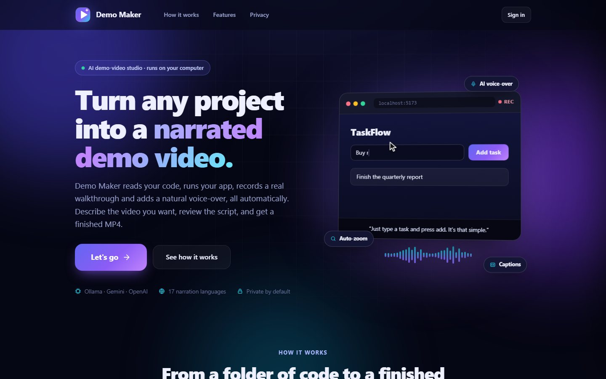
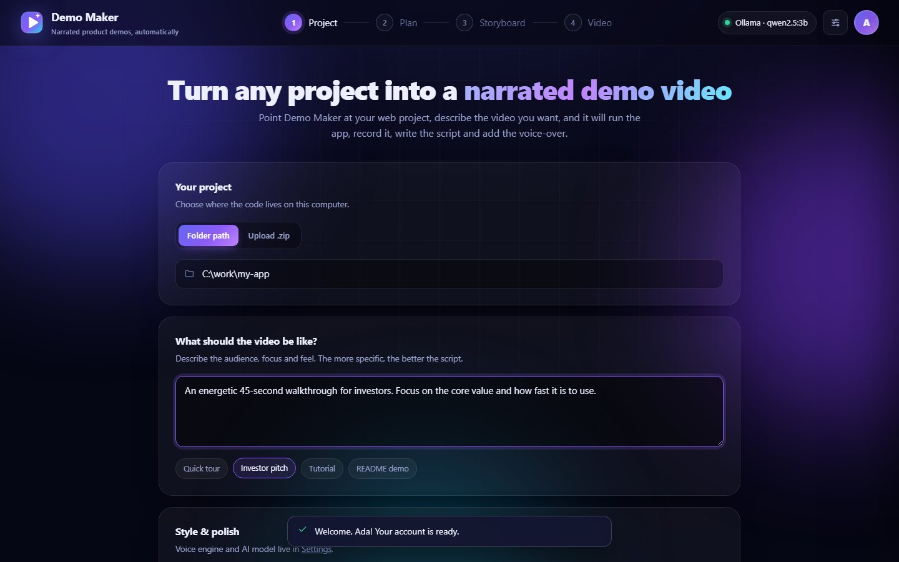
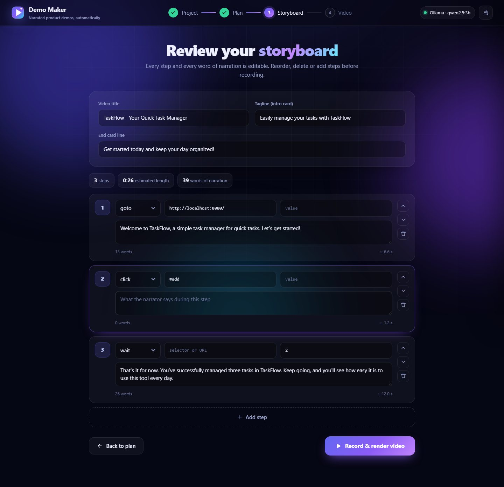
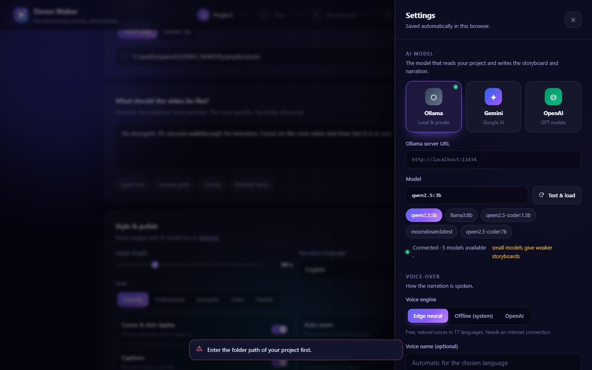
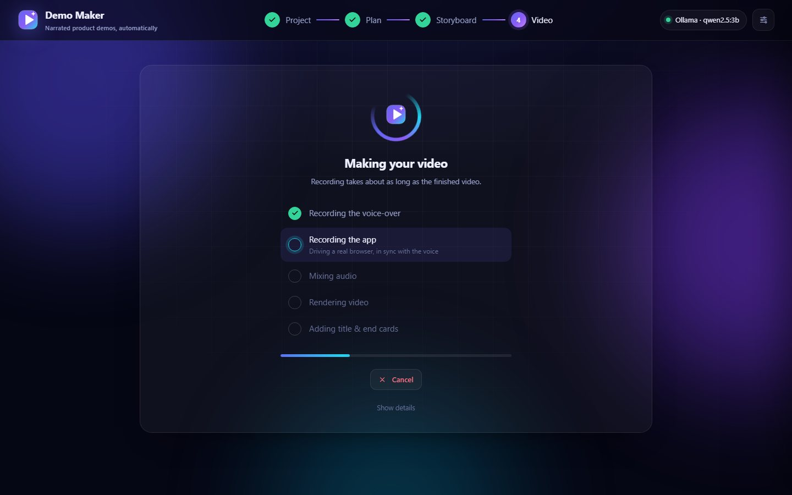

<div align="center">

# Demo Maker

**Turn any web project into a narrated demo video, automatically.**

Point it at your code, describe the video you want, and Demo Maker runs your app, records a real walkthrough,
writes the script and adds a natural voice-over. Powered by a local LLM (Ollama), Gemini or OpenAI.



</div>

---

## What it does

1. **Understands your project.** An LLM reads your file tree, README and config files and works out how to install and start the app. If the app fails to start, it is given the error output and repairs its own plan (up to two retries).
2. **Records a real walkthrough.** A headless Chromium browser (Playwright) drives your running app: clicking, typing realistic sample data and scrolling. Each step is paced to the length of its narration so picture and voice stay in sync.
3. **Writes and speaks the script.** One narration line per step, in 17 languages, spoken with free neural voices, OpenAI voices or fully offline system voices.
4. **Lets you steer.** Describe the audience, focus, tone and length in plain language, then review and edit the storyboard (every step and every word) before anything is recorded.
5. **Polishes the result.** Visible cursor with click ripples, smooth auto-zoom, burned-in captions (plus a `.srt` file), soft background music that ducks under the narrator, and title and end cards.

## Screenshots

| Describe the video | Review the storyboard |
|---|---|
|  |  |
| **Choose your AI model** | **Watch it work** |
|  |  |

## Quick start (Windows)

**Requirements:** Windows 10/11, Python 3.11+, and either [Ollama](https://ollama.com) with a model pulled, or a Gemini / OpenAI API key.
Node.js is only needed if the projects you demo use it. FFmpeg is bundled (through `imageio-ffmpeg`), so there is nothing else to install.

```bat
git clone https://github.com/noobder/Demo-maker.git
cd Demo-maker
setup.bat        :: once: creates .venv, installs packages and Chromium
run.bat          :: starts the app
```

Then open **http://127.0.0.1:8765**, create an account, and click **Let's go**.

<details>
<summary>macOS / Linux (not tested)</summary>

```bash
python3 -m venv .venv && source .venv/bin/activate
pip install -r requirements.txt
python -m playwright install chromium
python -m uvicorn app.main:app --host 127.0.0.1 --port 8765
```

Demo Maker was built and tested on Windows 11. The code has non-Windows paths (process handling, virtualenv layout) but they have not been exercised.
</details>

**Want to try it right away?** Point it at the bundled sample app: `samples/todo` (a tiny static task manager).

## Using it

1. **Create an account** (stored only on your computer) and click **Let's go**.
2. **Settings → AI model.** Pick a provider and model. Ollama is detected automatically and your installed models appear as chips.
3. **Project.** Enter a folder path or drop a `.zip`, describe the video, and choose length, tone, language and polish options.
4. **Plan.** Check the start command and URL it proposes. Install, sample-data and environment variables are under *Advanced*.
5. **Storyboard.** Edit, reorder, add or delete steps and narration.
6. **Video.** Wait for the recording, then watch and download the MP4 and captions.

### Choosing an AI model

| Provider | Setup | Notes |
|---|---|---|
| **Ollama** (local) | Install Ollama, then `ollama pull <model>` | Private and free. Use a 14B+ model for good storyboards; models of ~3B often write weak or repetitive plans. |
| **Google Gemini** | Paste an API key in Settings | Uses Google's OpenAI-compatible endpoint. |
| **OpenAI** | Paste an API key in Settings | A custom base URL also works for any OpenAI-compatible server. |

The model reads and plans; it never executes anything itself. Commands come from the run plan you review.

### Voice-over

| Engine | Needs | Quality |
|---|---|---|
| **Edge neural** (default) | Internet, no key | Natural, 17 languages |
| **OpenAI** | OpenAI provider with a key | High quality |
| **System (offline)** | Nothing | Depends on voices installed in your OS |

## How it works

```
 project folder ─► Analyze ─► Run plan ─► Start app ─► Explore pages ─► Storyboard
                    (LLM)     (you edit)   (isolated)   (Playwright)     (LLM, you edit)
                                                                              │
 final.mp4 ◄─ cards ◄─ zoom + captions ◄─ mix audio ◄─ record app ◄─ voice-over per step
```

- **Sync:** narration is synthesized first, so each step's length is known. The recorder then holds every step until its narration has finished, and the audio track is assembled from the measured start times.
- **Grounded plans:** the storyboard is written from real selectors found in the running app, not guessed from source code.
- **Zoom** is applied in post-processing, frame by frame, so it never breaks page layouts.

## Project layout

```
app/
  main.py        FastAPI app: pages, auth, job API, protected downloads
  auth.py        accounts: scrypt hashes, sessions, login throttling (SQLite)
  jobs.py        job state and the three stages: analyze, storyboard, render
  analyzer.py    reads the project, builds and repairs the run plan
  runner.py      installs and starts the project; process cleanup; port check
  discover.py    snapshots the running app (selectors, headings, page height)
  storyboard.py  turns snapshots + your description into steps and narration
  llm.py         Ollama / Gemini / OpenAI behind one interface
  tts.py         Edge, OpenAI and offline voices
  recorder.py    drives the app in a recorded browser, paces steps to narration
  compose.py     FFmpeg: audio track, music ducking, zoom, captions, cards
static/
  index.html     the workspace UI    landing.css, auth.js   landing + sign-in
samples/todo/    tiny app to try it on
docs/screenshots/
workspace/       created at runtime: accounts DB and per-job files (git-ignored)
```

## Security and privacy

- **Local only.** The server binds to `127.0.0.1`. Do **not** expose it to a network: it runs the install and start commands from the run plan.
- **You approve every command.** The run plan is shown and editable before anything runs.
- **Isolated installs.** Python projects are installed into a throwaway virtual environment in the job folder, never into your own Python.
- **No orphaned processes.** On Windows, apps started for a demo are tied to the server and die with it, even if it is killed.
- **Accounts.** Passwords are hashed with scrypt. Sessions are random tokens in an HttpOnly cookie, stored only as hashes. Each account sees only its own jobs and can download only its own videos. Five failed logins lock that email for 10 minutes.
- **API keys** stay in your browser's local storage (per account) and are sent only to the local server, which forwards them to your chosen provider.
- **Your project's data.** Apps are run in place, so an app that writes to a database will write to your real one. Demo a copy if that matters.
- There is no password reset (no email). To start over, stop the server and delete `workspace/users.db`.

## Known limitations

- **Web apps only.** CLI and desktop apps cannot be recorded yet.
- **Needs a working project.** Apps that require a database, auth or API keys need those supplied in the run plan's environment box.
- **Model quality matters.** Small local models plan poorly; review the storyboard before rendering.
- **Provider testing.** Ollama is the most thoroughly tested path. The Gemini and OpenAI backends (and the OpenAI voice) are implemented but have only been exercised against error responses, not with real keys.
- **Captions for non-Latin scripts** depend on fonts available to FFmpeg and may show boxes. The `.srt` file is always written.
- **Jobs are held in memory.** Restarting the server ends running sessions (finished videos stay on disk in `workspace/`). There is no history page yet.

## Troubleshooting

| Problem | Fix |
|---|---|
| *"Something is already listening at http://localhost:…"* | Another program is using the app's port. Stop it, or change the port in the run plan. |
| *"Could not reach ollama"* | Start Ollama (`ollama serve`) and check the server URL in Settings. |
| Storyboard is poor or repetitive | Use a larger model (Settings → AI model) and be specific in your description. |
| App never becomes ready | Open *Show details* on the progress screen to see the app's own output, then fix the start command or environment in the run plan. |
| Forgot your password | Stop the server and delete `workspace/users.db`. |

## Roadmap ideas

Vision check of screenshots, export presets (9:16 for Shorts/Reels, GIF for READMEs), CLI app recording, "run on a copy" mode, Docker sandboxing, a past-videos history page.

## Tech

Python · FastAPI · Playwright · FFmpeg (imageio-ffmpeg) · edge-tts · SQLite · vanilla JS/CSS (no build step)
